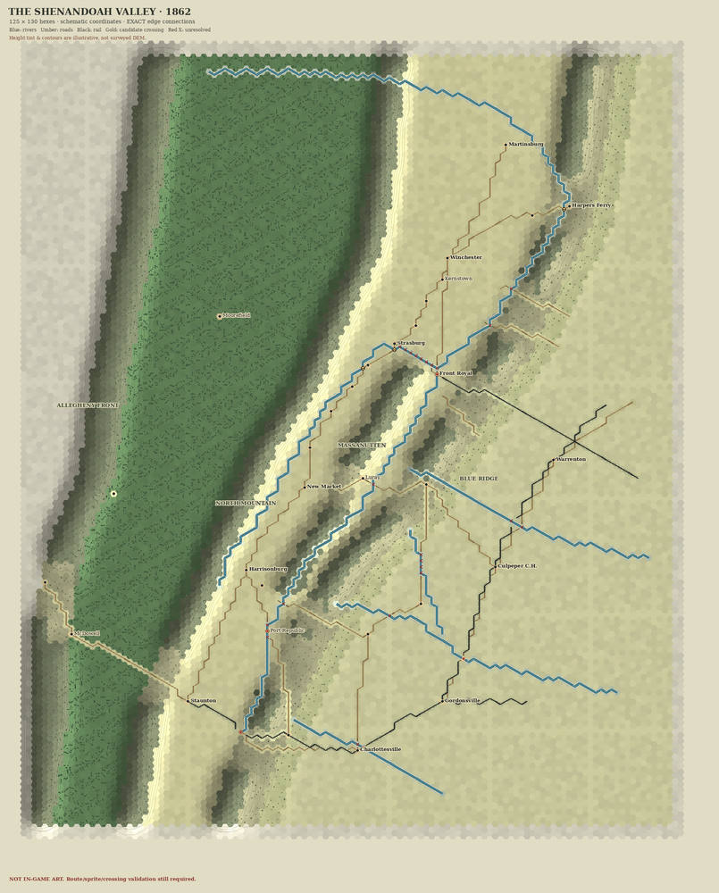

# Valley Campaign 1862 — v3 map-builder review and edge-exact preview

**Status:** Experimental diagnostic only. No `.sav` was written, the player's original map was not overwritten, and no Hex of Steel in-game compatibility test has been performed. The attached `build_valley_map_v3.ps1` and four companions were examined as **reference inputs**. All 125 × 130 coordinates remain schematic and have not been georeferenced to the user's nineteenth-century source maps.

## Why this v3 builder is worth keeping

Compared with the older merged PowerShell builder, v3 preserves rivers, roads and rails in separate sets until selecting native tiles; protects mountain gaps; recognizes `FilterRiver`, candidate `FilterRoadBridge`, and `FilterRailroad`; removes unconditional Workshop deployment; and supplies a safe geometry-only audit. Those are strong design choices. The supplied seven tests pass, but they verify only the **declared** geometry.

The two current source maps (period topographical Valley panorama and detailed New Market area) establish the historical *kind* of information we should collect: highland contours, road and rail alignments, streams, farmsteads, gaps, villages, mills, and crossings. Their unregistered scan pixels must **not** be assigned directly to specific game hex coordinates. Named crossings in v3 are **candidate sites, not verified bridges**.

## Newly reproducible failures in v3

Run:

```bash
python valley_v3_connections.py build_valley_map_v3.ps1 --json valley_v3_connection_audit.json
python -m unittest test_geometry.py test_valley_v3_connections.py -v
python render_valley_v3_network.py --script build_valley_map_v3.ps1 --output Valley_Map_v3_edge_exact.png
```

The audit deliberately exits nonzero until required connections/crossings/art are resolved; **that is not a test failure**. The two unittest modules completed successfully (15 tests).

| Finding | Evidence from uploaded 125×130 v3 | Why it matters |
|---|---:|---|
| Spurious connections in the old preview due to set-based neighbor joining | **29** (3 river, 22 road, 4 rail) | Visually creates turns/junctions absent from actual traced routes |
| Road/river or railroad/river collision records | **41** route-layer intersections | Requires site-by-site crossing analysis; not necessarily 41 bridges |
| Unresolved collision records | **33** (can include the same hex once for road and once for rail) | Route must remain broken over water until a documented crossing is encoded |
| River-water crossings lacking a rail-capable bridge | **12** rail/river intersections | The v3 bridge tile explicitly has `Railroad=false`; trains cannot be asserted to pass |
| Towns occupying river hexes | **4**: Waynesboro, Port Republic, Front Royal, Orange C.H. | The city-over-water precedence removes a river from the playable tile |
| River masks without an exact inspected asset | **12** endpoint masks | Requires genuine source/sink/end-cap graphics or appropriate neighboring tile behavior |
| Rail masks without an exact inspected asset | **7** (5 endpoint, 2 junction) | No nearest-looking railroad variant may silently drop an exit |
| Road port masks | **506 unverified** | `Road1..Road9` physical sprite port inventory is not established; not proof all roads need custom art |

`valley_v3_connections.py` keeps an **ordered edge graph for every named feature**. Its preview draws only truly traced route edges. It paints roads under rivers except at candidate crossings, where a candidate marker is shown. Unresolved joins receive red Xs and blocked rail/water connections are not rendered as continuous track. River junctions are not chosen by arbitrarily discarding branches.

### The old `render_atlas.py` must not be shipped as tile art

1. Its `PLATE_FILES` point to fixed `/workspace/artifacts/imagine_images` locations that are absent from the supplied files, so the atlas cannot reproduce on this machine.
2. `world_patch()` selects cropped source art by modular offsets per hex, with no guarantee neighboring patches share edge pixels or elevations. This **cannot** solve 3D seams.
3. `VARIANTS` covers nine two-exit shapes. It has no explicit three-exit, four-exit, endpoint or bridge/rail junction atlas. The actual inspected Railroad6–9 directions differ from River6–9 in PR #5.
4. Its tile art is square 2000×2000 with a hex-shaped transparency mask, but a decorative 2D shaded texture is **not** a Unity terrain mesh. A town painted next to a raised hill cannot be made smooth by color blending alone.
5. It hardcodes *one mile per hex* into its picture even though the source map coordinates are not yet calibrated. It also paints Summer art for a March campaign without a verified game-season change.

The new `render_valley_v3_network.py` uses **original procedural color and cosmetic interpolated relief** (no missing plates). It fixes the topology and shows a muted spring palette, but does **not** claim to be a DEM, historic cartographic result or native tile atlas. It deliberately preserves visibly unresolved geographic and sprite problems for review.

## Required fixes to make the actual Hex of Steel map function

1. **Do not change the active save**. Work from a copy and a trusted editor-exported `.sav` with source hashes. Version-lock the mod's real tile names, `Season` lookup, bridge and rail semantics.
2. **Georeference** the period source using a measured coordinate transform, error bounds, and fixed anchors (Winchester, Strasburg, New Market, Luray, Harrisonburg, Staunton, Front Royal, Harpers Ferry). Use the period sources to verify the correct 1862 tracks, roads, passes, water channels, farmsteads and names.
3. Convert each named line to an independent edge network with six bitmask ports, enforce reciprocal ports and preserve route identity. Keep base terrain, road, railroad, river, bridge and label layers separated in the intermediate format, even if the native game requires composites for display.
4. **Audit all 1862 crossings.** A line running across a river in a traced input is not evidence of a bridge. Ford, bridge, ferry and railroad bridge must be distinct historic/engine concepts. Rail crossings cannot reuse a nonrail bridge and pretend trains work.
5. Produce the missing **exact edge-mask art** and test that pixels land at the same six edge anchors in a multi-hex stitch sheet. If the game supports only single tile sprites, design intersection-composite artwork using verified basenames, with no invented filenames in the playable output.
6. **Real relief requires common world-space heights**: sample one DEM in a map-wide coordinate system, share exactly the same boundary vertices and displacement noise across neighbors, and derive road grades/building foundations from the local ground surface. Cosmetic hillshade alone is not geometry.
7. Validate the map *inside Hex of Steel*: loading, saving, AI pathfinding, river blocking, bridges destruction/rebuilding, train traversal, road and mountain movement, strategic zoom performance. Separate `PASS`/`FAIL`/`NOT_TESTED` for each criterion.

## Suggested first geographic correction batch

* **Shenandoah forks / Massanutten:** South Fork is east of Massanutten; North Fork west; both meet near Front Royal. v3 fixes the reversal in the abandoned coarse PR #1, but specific hex paths remain provisional.
* **Strasburg–Front Royal:** source-check the North Fork crossings and historical Manassas Gap Railroad right-of-way. The present route has several rail/water intersections with no legal train bridge.
* **Port Republic / Waynesboro:** keep streams beneath town labels rather than silently replacing them with buildings. Verify bridges and roads on the original map before assigning native tiles.
* **Winchester–Staunton Valley Pike:** preserve this operational corridor end to end, but audit exact grades, connecting side roads, elevation and placement against period map control points.
* **Blue Ridge / Massanutten gaps:** mountain tiles must not erase the route, but a broad rectangular hole in the ridge is not a verified gap. Only documented roads through correct passes should grant movement.

**Branch policy:** These are additional candidate tooling and evidence for the open topology-repair PR. Preserve all audited images and save data. Do not merge without a reliable in-game verification plan.

## Edge-exact preview



The image above is a reduced diagnostic preview, not a native game screenshot, DEM, or historical georeferencing result. Rebuild it using `python render_valley_v3_network.py --script build_valley_map_v3.ps1 --output Valley_Map_v3_edge_exact.png`.
